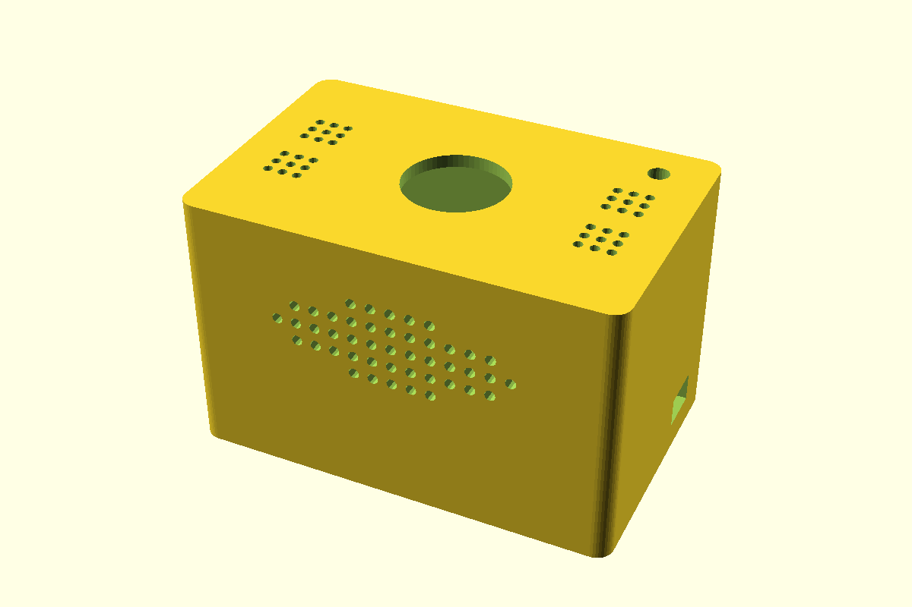

# ESP32 Voice Box

[](https://github.com/zhandos717/esp32-voice-box/actions/workflows/ci.yml)
[](LICENSE)

**English** · [Русский](README.ru.md)

A walkie-talkie between a child and family on Telegram. A small box with an ESP32, a microphone, a speaker and two buttons:
hold the button and speak, and the message lands in a Telegram chat. Voice and text messages from the chat come back and play
on the box speaker.



## Features

- **Push to talk.** Hold the button to record; recording keeps going for 2.5 s after release, so the last word is not cut.
  The button click at the start is removed and silence at the end is trimmed.
- **Telegram bridge.** Recordings go to a chat or a forum topic. Voice notes, audio files and video notes from the chat are queued
  on the box; the sender gets 👌 when the message has been played.
- **Text to speech.** Text messages are read aloud. Russian and Kazakh are detected automatically. Voices: Microsoft neural voices
  (Azure key, or edge-tts without a key), Piper offline, plus cartoon effects (chipmunk, robot, bear…). Each chat member can have
  their own voice.
- **New-message chime** on the box, repeated quietly while something is unplayed.
- **Telegram Mini App** control panel: live status over SSE, board telemetry, voices, sounds, firmware update, button and LED test.
  Vue 3 without a build step, in Russian, Kazakh and English.
- **IMA ADPCM** audio both ways: four times less traffic, works on weak Wi-Fi.
- **Battery level** of an 18650 cell in the panel, with a Telegram warning at 15 %.
- **OTA updates** with automatic rollback if the new firmware does not reach the server.
- **3D-printable enclosure** (OpenSCAD and STL) in [hardware/enclosure](hardware/enclosure).

## How it works

```
 ESP32 box ──Wi-Fi, TCP 8800 (password)──▶ Go server ──▶ recordings/*.wav
  mic, speaker, buttons, LEDs                 ├──▶ Telegram bot (long polling)
                                              └──▶ Mini App over HTTPS (nginx)
```

| Part | What |
|---|---|
| Board | ESP32 DevKit (no PSRAM needed), Arduino core esp32 3.3.x |
| Microphone | INMP441 (I2S) |
| Speaker | MAX98357A amplifier (I2S) and a 3–4 W speaker |
| Controls | record button, "next" button, three LEDs |
| Server | Go, no external dependencies; ffmpeg for Telegram audio |

Wiring: [docs/wiring.md](docs/wiring.md) · protocol: [docs/protocol.md](docs/protocol.md).

## Quick start

1. **Firmware.** Build and flash `firmware/mic_stream`:
   ```bash
   arduino-cli compile --fqbn esp32:esp32:esp32 firmware/mic_stream
   arduino-cli upload  --fqbn esp32:esp32:esp32 -p <port> firmware/mic_stream
   ```
2. **Wi-Fi** (2.4 GHz): on first start the box opens a `VoiceBox-XXXX` network. Join it from a phone and the setup page opens
   by itself. To change the network later, hold both buttons for 3 s while powering on. Over USB works too:
   ```bash
   python tools/set_wifi.py <port> --show
   ```
3. **Server.** Copy `.env.example` to `.env`, set `TELEGRAM_BOT_TOKEN` and `MIC_TOKEN`, then:
   ```bash
   cd server
   go build -o mic_server .
   ./mic_server
   ```
   The web panel is at http://127.0.0.1:8801. Write `/id` to the bot in your chat to get `TELEGRAM_CHAT_ID`.
4. **VPS with HTTPS and the Mini App:** [docs/deploy-vps.md](docs/deploy-vps.md). Telegram setup: [docs/telegram.md](docs/telegram.md).

All settings are listed in [.env.example](.env.example). Troubleshooting: [docs/troubleshooting.md](docs/troubleshooting.md).

## Tests

```bash
cd server && go vet ./... && go test ./...
```

`scripts/test.ps1` also runs an end-to-end test with a fake board and a fake Telegram API.

Most docs are in Russian; issues and pull requests in English or Russian are welcome.

## Contributing

See [CONTRIBUTING.md](CONTRIBUTING.md). Security issues: [SECURITY.md](SECURITY.md).

## License

[MIT](LICENSE). Bundled third-party code: [THIRD_PARTY.md](THIRD_PARTY.md).
